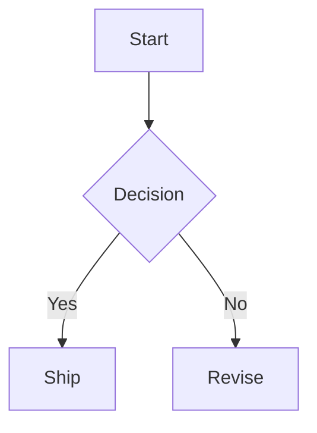

# Phase 1 State, Document Model, and Code Flow

Source of truth: `specs/MERMAID_LOCAL_UPDATED_SPEC.md`

## Direction Change

The old state model was lane/task-first. The updated app is Mermaid-code-first. The canonical document state is the `.mmd` text plus metadata, diagnostics, render state, source map, and snapshot metadata.

## Frontend Document State

Recommended Zustand slice:

```ts
interface DocumentState {
  documentId: string | null;
  filePath: string | null;
  fileName: string;
  content: string;
  lastSavedContent: string;
  diagramType: string | null;
  diagnostics: ParseDiagnostic[];
  lastGoodSvg: string | null;
  renderStatus: "idle" | "rendering" | "error";
  modified: boolean;
  snapshotNumber: number | null;
}
```

## Core State Rules

- Monaco model text is the active source of truth for diagram content.
- `content` mirrors Monaco and is used for persistence, render, snapshots, and AI prompts.
- Render state can fail without changing `content`.
- `lastGoodSvg` remains visible after parse/render errors.
- `modified` is computed by comparing `content` with `lastSavedContent`.
- Visual edits in Phase 4 must update Monaco through edit operations, not mutate separate diagram state.

## Initial Diagram

Use a supported Mermaid opener:



Do not use `swimlane`; prior browser verification confirmed it is not accepted by Mermaid in the current setup.

## Render Flow

1. Monaco emits content change.
2. Store updates `content` and `modified`.
3. Debounced render request starts after roughly 150ms.
4. Mermaid validates/renders.
5. On success: update `lastGoodSvg`, clear diagnostics, update detected diagram type.
6. On failure: keep `lastGoodSvg`, set diagnostics and error state.
7. Snapshot debounce runs independently after roughly 800ms idle once Phase 3 exists.

## File Flow

- `openFile` returns path and text.
- Store replaces document content and last saved content.
- Opening creates a future snapshot trigger once Phase 3 exists.
- `saveFile` writes current content.
- Save success updates `lastSavedContent` and `modified`.

## Future AST Bridge

Phase 1 does not need a full AST. It should prepare interfaces that Phase 4 can replace:

- `detectDiagramType(code)`
- `parseForDiagnostics(code)`
- `buildSourceMap(code, svg)`
- `applyPatch(code, patch)`

In Phase 1 these can be minimal wrappers. Do not bake lane/task assumptions into them.

## Tests

- valid Mermaid updates `lastGoodSvg`
- invalid Mermaid preserves previous `lastGoodSvg`
- modified state toggles correctly
- file open replaces content
- file save updates `lastSavedContent`
- diagram type detection handles the opener keywords listed in the updated spec
